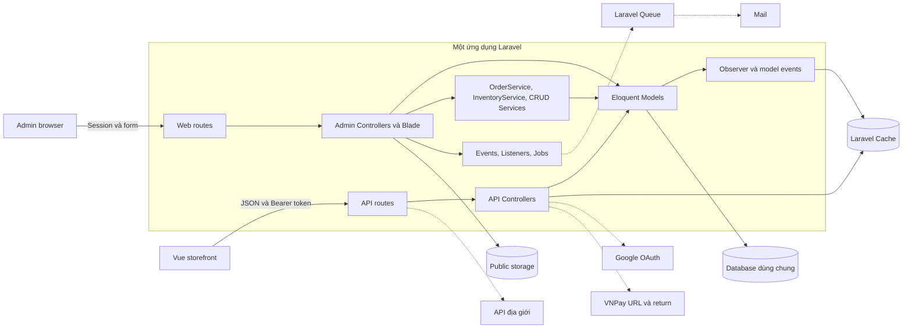

# Kiến trúc hiện tại

**Cập nhật P8 — 2026-10-30:** Catalog có port `CatalogProjectionEvents` mặc định no-op, cuối SaveProduct transaction. Nhánh `experiment/p8-catalog-reporting` có adapter opt-in/guarded outbox và prototype Reporting consumer với logical database/credential riêng, chạy PDO process không boot Laravel. Source vẫn sáu module, 56 migrations, không P8 tables; HTTP readers/checkout/payment/stock giữ nguyên. [P8_STATUS](../roadmap/P8_STATUS.md), [verification](p8-verification.json), [ADR-020](architecture-decisions.md). Thử nghiệm chỉ sandbox; không deployment microservice production. Các snapshot trước giữ làm lịch sử.

**Cập nhật P7 — 2026-10-30:** thêm Reporting read adapters cho inventory filters/CSV và diagnostics; detail dùng chung tập stock; display cache scoped/generation invalidation sau commit. Database queue after-commit, coupon retry/timeout hữu hạn, Monolog redaction và Telescope opt-in/admin middleware. Không đổi sáu module, stock protocol, schema hoặc dependencies. [P7_STATUS](../roadmap/P7_STATUS.md), [số liệu](p7-performance-after.json), [verification](p7-verification.json), [runbook](../runbooks/P7_OPERATIONS.md). Worker/scheduler/restore/release-cache đã rehearsal sandbox; task Windows giữ Disabled, CI remote và vận hành production chưa xác minh. Snapshot P0–P6 dưới đây là lịch sử.

**Cập nhật P6 — 2026-10-30:** đã hoàn thành MVP lifecycle COD/refund thủ công/hàng trả, coupon reservation/redemption, phiếu kho/discrepancy, settings và catalog/account/archive an toàn. Các luồng tiếp tục dùng sáu module và local transaction MySQL của P5. Schema P6 đã rollout sau full backup/restore/rehearsal, hiện 56 migrations; dữ liệu ở các cột cũ của 20 bảng giữ nguyên. Regression 196 tests/2.119 assertions, một skip đúng nhánh DB-disabled. Windows scheduler task hiện Disabled; chưa xác minh worker/provider thật. Xem [P6_STATUS](../roadmap/P6_STATUS.md), [runtime artifact](p6-runtime-verification.json), [contract P6](p6-lifecycle-contract.md), [ADR-018](architecture-decisions.md). Các snapshot dưới đây giữ nguyên lịch sử thời điểm audit/P0–P5.

**Trạng thái P5 — 2026-10-29:** các luồng checkout, quote, stock, payment notification, transition và expiry đã có sáu module Identity/Catalog/Pricing/Inventory/Payments/Ordering, public Contracts + readonly DTO, Domain/Application độc lập Laravel và Eloquent Infrastructure có ownership. Payments không còn import Order/reservation; Ordering điều phối transaction chung, legacy services là adapter. Không đổi schema/route/payload P4, không thêm dependencies. [Ranh giới và adapter registry](p5-module-boundaries.md), [P5_STATUS](../roadmap/P5_STATUS.md), [runtime read-only](p5-runtime-verification.json). CRUD cũ giữ nguyên owner/ngoại lệ đã ghi rõ; không tuyên bố mọi controller đã di chuyển. Các cập nhật dưới đây là lịch sử.

**Trạng thái mới nhất sau review P0–P4 — 2026-10-29:** đã rollout payment/history và inventory protocol sau full backup, restore clone và rehearsal. DB ứng dụng có 55 migrations/48 bảng; metadata-only backfill 18 đơn, cách ly 27 đơn và giữ nguyên 40 đơn vị reserved chưa xác định chủ. Checkout có operation key, allocation một kho active, reservation identity; mọi writer nghiệp vụ đi qua StockWriter. Confirm không trừ vật lý, shipping mới trừ. `.env` bật hai gate kho/chuyển trạng thái; VNPay mới vẫn tắt. Scheduler Windows mỗi phút đã kiểm chứng, chỉ chạy khi user đăng nhập. Xem [contract P4](p4-inventory-contract.md), [cutover report](p4-cutover-report.json), [P4_STATUS](../roadmap/P4_STATUS.md). Các ghi chú “chỉ sandbox/chưa rollout” bên dưới mô tả thời điểm cũ, được cập nhật bởi đoạn này. Chưa triển khai module namespace P5 hoặc tuyên bố toàn bộ hệ thống production-ready.

**Cập nhật P3 — 2026-10-29:** code có transition policy tại service, row lock/read lại order, operation/history, guard allocation legacy và stock context. Confirm giữ tồn, shipping mới giảm quantity. Chỉ chạy schema/tests trên sandbox; DB ứng dụng chưa có order_transitions và transition mới mặc định tắt. [P3_STATUS](../roadmap/P3_STATUS.md) ghi giới hạn, dry-run và rollout còn chờ review. Nội dung audit cũ dưới đây giữ làm baseline lịch sử.

**Cập nhật P2 — 2026-10-29:** mô tả audit bên dưới là baseline lịch sử. Code hiện tại đã có server quote/SKU validation, cart policy/active gate, payment attempts/events + verified IPN, read-only return, OAuth one-use handoff và error redaction. Xem [P2 status](../roadmap/P2_STATUS.md), [contracts](p2-http-contracts.md). Payment migration mới chỉ chạy trên sandbox; DB ứng dụng chưa có hai bảng mới và online mặc định tắt. Allocation/transition issues P3/P4 vẫn còn.

Ngày lập: 2026-10-28. Trạng thái: mô tả source đã audit, không phải chứng nhận vận hành production.

**Bổ sung cùng ngày:** đã đọc [database export analysis](database-export-analysis.md) từ `laravel.sql`. Export xác nhận MySQL 8.0.30/InnoDB và đã có role/blocked/thumbnail/commit; các khác biệt này là migration drift, không phải thiếu cột/enum trên snapshot. Phần audit source bên dưới được giữ làm lịch sử; các câu “chưa xác minh schema” cần đọc cùng phần bổ sung. Runtime DB vẫn chưa được truy cập. Export còn cho thấy bất nhất trạng thái đơn/reservation và tổng tiền cần đối soát.

**Cập nhật triển khai P0:** đã kiểm tra endpoint MySQL từ `.env` bằng PDO và transaction READ ONLY, không boot Laravel: 8.0.30, REPEATABLE-READ, 40 bảng InnoDB, 50 migrations; selected columns và số dòng nghiệp vụ khớp export ở phạm vi kiểm tra. Xem [runtime baseline](p0-runtime-baseline.json), [route inventory](p0-route-baseline.md) và [báo cáo P0](../roadmap/P0_STATUS.md). Đây không phải xác minh toàn bộ runtime cache/deployment. Các đoạn “chưa truy cập DB” phía dưới là lịch sử audit trước P0.

**Cập nhật P1:** đã thêm Laravel schema baseline và một migration repair mới, không sửa migration lịch sử. DB ứng dụng hiện có 51 migrations, user.code unique và không còn mã rỗng; thumbnail nullable đúng validation. User model tạo UUID 32 ký tự khi tạo tài khoản thiếu code. Xem [P1_STATUS](../roadmap/P1_STATUS.md), [metadata sau P1](p1-runtime-baseline.json) và [bằng chứng bảo toàn dữ liệu](p1-verification.json). Orders/items/inventory/movements giữ nguyên toàn bộ row fingerprints; chỉ 4 user codes rỗng được map. Các lỗi tiền/tồn/quyền ở audit vẫn chưa sửa.

## 1. Phạm vi và mức độ xác minh

Đã khảo sát routes, dependencies, cấu trúc Backend, models và quan hệ; đọc sâu checkout, order, cart, inventory, authentication, category, product, coupon và migrations liên quan. Đã đối chiếu frontend services/stores, cấu hình test, queue, cache và hướng dẫn deployment.

Chưa đọc toàn bộ từng dòng Blade/Vue, nội dung, uploads, seeders và thư viện bên thứ ba. Chưa chạy ứng dụng, test, migration, benchmark hoặc truy vấn database. Database đang chạy, migration history, engine/version, isolation level, queue worker, scheduler và hạ tầng production: **Chưa xác minh**. Các lỗi runtime nêu dưới đây là hệ quả suy ra từ source, chưa được tái hiện trên môi trường cách ly.

## 2. Stack và tổ chức

| Thành phần | Bằng chứng |
| --- | --- |
| PHP/Laravel | [composer.json](../../composer.json): PHP ^8.2, Laravel ^11.0; [composer.lock](../../composer.lock) khóa Laravel 11.45.1 |
| ORM | Eloquent, migrations, SoftDeletes, model events |
| Authentication | Sanctum 4.2.0, session admin, Socialite 5.23.0 cho Google |
| Database | Cấu hình local đã đọc khai báo MySQL; [config/database.php](../../config/database.php) và `.env.example` mặc định SQLite. Không ghi credentials vào tài liệu |
| Storefront | [frontend/package.json](../../frontend/package.json): Vue 3, Vite, Pinia, Vue Router, Axios |
| Admin | Controllers trả Blade views trong `resources/views/admin` |
| Hạ tầng ứng dụng | Laravel Cache, Queue, Jobs, Mail; Telescope; public file storage |
| Tích hợp | VNPay, Google OAuth, API địa giới; có code AI chưa nối thành luồng hoàn chỉnh |
| Test/deployment | PHPUnit; Sail có trong require-dev. Chưa tìm thấy Dockerfile/Compose/CI của dự án trong phạm vi khảo sát |

Backend nằm tại root, chia thư mục theo kỹ thuật: `Controllers`, `Requests`, `Models`, `Services`, `Jobs`, `Events`, `Listeners`, `Observers`, `Traits`. Đây là monolith, chưa có module boundaries được thực thi.

## 3. Giao tiếp và kiến trúc

Sơ đồ thể hiện đường gọi trong code, không khẳng định worker hoặc tích hợp đang vận hành.

[frontend/src/services/api.js](../../frontend/src/services/api.js) lấy token từ localStorage, gửi Bearer và gọi `/api`. [frontend/vite.config.js](../../frontend/vite.config.js) proxy development tới `127.0.0.1:8000`. Production proxy/CORS: **Chưa xác minh**. Admin dùng middleware `auth`, `is_admin`; API khách hàng dùng `auth:sanctum`. [bootstrap/app.php](../../bootstrap/app.php) chưa có exception mapping nghiệp vụ riêng.

## 4. Module nghiệp vụ thực tế

| Nhóm | Đã có trong source | Chưa hoàn chỉnh/chưa tìm thấy |
| --- | --- | --- |
| Identity | Login/register, Google, admin, user status/role | Account status cho mọi API; quyền theo kho |
| Catalog | Category cây, product, SKU, specs, ảnh, barcode, thuộc tính, soft delete | Schema/validation nhất quán; một số action Attribute còn trống |
| Inventory | Kho, nhập/xuất/chuyển, điều chỉnh, kiểm kê, reserve/commit/release, báo cáo CSV | Allocation theo order item; concurrency và lifecycle reservation đầy đủ |
| Ordering | Cart, checkout, order/items, lịch sử, admin chuyển trạng thái | Idempotency; hủy sau confirm; return end-to-end |
| Payments | COD, tạo URL và VNPay return | Xác thực callback, đối soát, payment attempts, refund |
| Promotions | Promotion polymorphic product/variant, banner, frame; cấp coupon và mail | Redeem coupon trong checkout |
| Content/engagement | Post/tag, wishlist, profile, review moderation | Chưa thấy route khách hàng gửi review |
| Notifications | Jobs thay đổi tài khoản và cấp coupon | Worker/retry thực tế chưa xác minh |
| AI | AIIntentService, ChatAIController, widget | Không thấy route chat; widget send còn placeholder |

Enum/cột `MOMO`, `refunded`, `return`, `incoming_quantity`, `approved_by` không chứng minh đã có các nghiệp vụ tương ứng.

## 5. Dữ liệu và luồng quan trọng

- Category → products → variants/specs; SKU unique.
- Warehouse × variant → inventory; bộ migration mới unique `(warehouse_id, product_variant_id)`.
- Inventory lưu `quantity`, `reserved_quantity`, `available_quantity`, `incoming_quantity`; transactions có trước/sau, tham chiếu nghiệp vụ, nguồn/đích.
- User → cart → items; order → order items có snapshot tên/giá; order có một warehouse_id.
- PromotionItem polymorphic; CouponUse liên kết coupon-user; banner-product nhiều-nhiều.

### Checkout

[CheckoutController::process](../../app/Http/Controllers/Api/CheckoutController.php) nhận cả giá từ client, tạo pending order, lấy inventory đầu tiên theo variant với `lockForUpdate`, reserve và ghi movement, ghi items/tổng tiền, xóa toàn bộ giỏ rồi commit. Sau commit trả COD hoặc URL VNPay.

### Xác nhận/hủy

[OrderService](../../app/Services/OrderService.php) dùng `order.warehouse_id`: pending → confirmed giảm quantity/reserved; pending → cancelled giảm reserved, tăng available. Admin cho phép confirmed → shipping → completed. Service chưa khóa/refresh order và chưa tự bảo vệ đầy đủ transition.

### Thanh toán

`vnpReturn()` cập nhật paid khi response code là `00`; không thấy kiểm tra chữ ký, amount hoặc payment attempt. Chưa thấy expiry/reconciliation cho hàng đã giữ.

### Concurrency

Checkout và commit/release có khóa inventory. Import/export/transfer/adjust/service reserve dùng đọc-sửa-save không có protocol khóa tương ứng. Transaction không tự loại bỏ lost update. Chưa có idempotency hoặc thứ tự khóa nhiều SKU thống nhất.

## 6. Rủi ro đã có bằng chứng

| ID | Mức | Vị trí | Vấn đề và tác động |
| --- | --- | --- | --- |
| C1 | Critical | CheckoutController::process | Giá request quyết định total; có thể mua với giá giả |
| C2 | Critical | CheckoutController::vnpReturn, routes API/Web | Request không xác thực có thể đánh dấu paid |
| C3 | Critical | CheckoutController, OrderService, Order model, migration warehouse của order | Reserve kho bất kỳ nhưng confirm/cancel dùng kho mặc định 1; tồn sai kho |
| H1 | High | database/migrations | Hai bộ create bảng kho ngày 09-08/09-14; `thumnail` khác `thumbnail`; thiếu migration role; `block` khác `blocked`; user code bắt buộc nhưng register không cấp; enum movement thiếu commit |
| H2 | High | Api/CartController::update/remove | Không kiểm tra ownership item |
| H3 | High | InventoryService | Race giữa các đường ghi tồn; invariant số lượng chưa được bảo vệ |
| H4 | High | Admin/OrderController, OrderService | Order đọc trước transaction, có thể confirm/cancel lặp |
| H5 | High | CheckoutController, console routes | Thiếu lifecycle reservation, idempotency, validation quan hệ SKU và null handling |
| H6 | High | Api/AuthController, GoogleAuthController | Bỏ qua account status; OAuth ghi đè password user cũ và đặt bearer token trong URL |
| H7 | High | orders/order_items migrations, forceDelete actions | Cascade có thể xóa lịch sử nếu không bị FK khác chặn |
| H8 | High | tests, phpunit.xml | Chỉ có hai ExampleTest; chưa cấu hình DB test riêng |
| M1 | Medium | CartController, Api/HomeController, InventoryController | cost_price vừa là giá bán vừa là giá vốn; cần xác minh ý nghĩa dữ liệu |
| M2 | Medium | Admin/ProductController | Lưu nhiều entity thiếu transaction; update variant không scope product |
| M3 | Medium | InventoryTransaction::generateTransactionCode | Đọc mã cuối rồi cộng gây trùng khi đồng thời |
| M4 | Medium | AssignCouponJob, CouponController, config/queue.php | Retry insert có thể cấp trùng; dispatch trước commit phụ thuộc queue backend |
| M5 | Medium | routes và frontend services | Có endpoint trỏ method chưa có hoặc FE khai báo API chưa tồn tại |
| M6 | Medium | Admin/OrderController, CheckoutController | dd trace và exception message trả ra client |
| M7 | Medium | InventoryController, Api/HomeController | OR filter không group; lazy load inventory; export get toàn bộ; report export bỏ movement commit |
| M8 | Medium | Inventory settings, Admin/UserController, Api/UserController | Settings không lưu; destroy user dùng phép gán; voucher query qua người tạo |
| L1 | Low | BaseCrudController, CategoryService | Generic base gọi getAllCate; getAll đổi kiểu kết quả ngầm |

Nguồn trọng tâm: [CheckoutController](../../app/Http/Controllers/Api/CheckoutController.php), [InventoryService](../../app/Services/InventoryService.php), [CartController](../../app/Http/Controllers/Api/CartController.php), [migrations](../../database/migrations), [phpunit.xml](../../phpunit.xml).

## 7. Nền tảng có thể giữ lại

Eloquent, migrations, FormRequest, DI, service layer hiện có, Observer cache, Events/Listeners, queue mail, unique/FK, decimal, snapshot order items, pagination và eager loading là nền tảng phù hợp. Cần thống nhất cách sử dụng trước khi bổ sung abstraction.

Tài liệu tiếp theo: [kiến trúc mục tiêu](target-architecture.md), [quyết định kiến trúc](architecture-decisions.md), [lộ trình](../roadmap/UPGRADE_PLAN.md).
