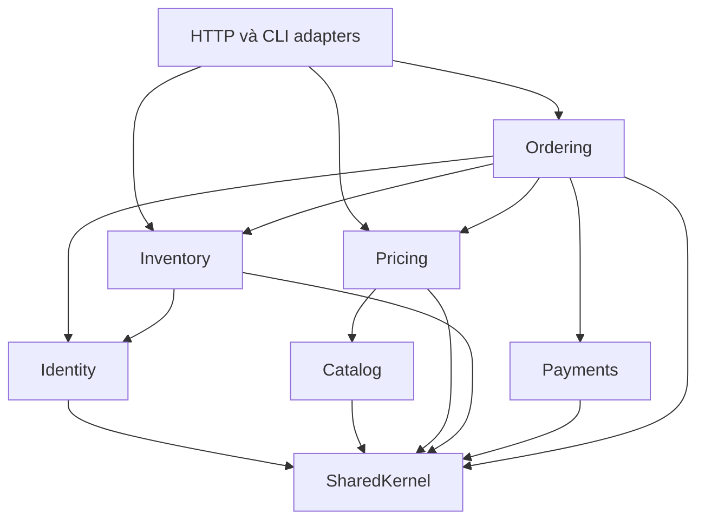

# Ranh giới module P5 đã triển khai

Ngày 2026-10-29. Đây là kiến trúc của các use case đã ổn định trong P2–P4, không phải tuyên bố đã di chuyển mọi CRUD. Không đổi schema, route hay payload HTTP. [Báo cáo P5](../roadmap/P5_STATUS.md) ghi acceptance, tests và giới hạn.

## Module và quyền sở hữu

| Module | Public Contracts | Persistence owner trong luồng đã chuyển |
| --- | --- | --- |
| Identity | AccountAccess | User/account status/role; EloquentAccountAccess chỉ đọc để xác minh actor |
| Catalog | SellableSkuReader, SellableSku | Product/ProductVariant; trả snapshot bán được, không trả model hoặc cost_price |
| Pricing | Pricing, Quote/QuoteLine | Quy tắc giá VND hiện có; nhận snapshot Catalog, không đọc trực tiếp Product |
| Inventory | InventoryOperations, InventoryReservations, InventoryMaintenance; allocation/hold DTOs | Warehouse, Inventory, operations, reservations/items, movements, discrepancies, legacy holds |
| Payments | PaymentGateway, PaymentLedger; Attempt/PaymentOrder/PaymentCandidate/PaymentResult | PaymentAttempt/payment_events; không import Order/InventoryReservation |
| Ordering | Checkout, OrderTransitions, PaymentWorkflow, ReservationExpiry, LegacyOrders; OrderSnapshot/TransitionReceipt | Order/OrderItem/Cart/OrderTransition; không import User/Product/Inventory/PaymentAttempt |

Models vẫn nằm trong app/Models để giữ quan hệ Eloquent và CRUD cũ. Module Infrastructure chỉ được import model thuộc owner của mình. Domain/Application/Contracts không import model hay Laravel. Public DTO là readonly; các payload batch/notification vẫn là native arrays theo contract P4, không chứa Eloquent/query builder.

inventory_operations là bảng protocol do Inventory sở hữu từ P4. Ordering sở hữu nội dung lệnh checkout, gọi InventoryOperations::execute để ghi operation và chạy transaction chung; không tạo kho operation thứ hai hoặc chuyển bảng trong refactor P5. Trước khi tách service phải thiết kế lại transaction/idempotency boundary, không đổi adapter sang remote trong khóa hiện tại.

## Dependency rules

Mũi tên giữa modules chỉ được đi qua Contracts. Inventory phụ thuộc AccountAccess của Identity để kiểm tra admin writer; đây là dependency bổ sung có lý do, không gọi Auth/session. Không có Payments → Ordering hoặc Inventory → Ordering import. Composition root là app/Modules/ModuleServiceProvider.php, được đăng ký trong bootstrap/providers.php.

- Domain giữ StockBalance, LegacyAllocationEvidence, OrderTransitionPolicy và PaymentDecision, không có I/O.
- Application điều phối PlaceOrder, ChangeOrderStatus, PaymentWorkflow, ExpireReservations, QuoteService qua ports/contracts.
- OrderStore là persistence port hẹp cho checkout/history/paid updates; EloquentOrderStore thực thi, không dùng generic repository.
- StockStore/StockWriter/ReservationManager và payment ledger/gateway là Infrastructure. Các lớp này được phép dùng Laravel cho SQL/config và mapping lỗi.
- SharedKernel chỉ có ActorContext, Clock, Transactions, Vnd và adapters kỹ thuật riêng trong Infrastructure. Không chứa nghiệp vụ tiền/tồn/order dùng chung tùy tiện.
- Hai exception root App/Exceptions/InventoryConflict và OrderTransitionConflict giữ nguyên mã/HTTP mapping để tương thích; chúng thuần DomainException, không phụ thuộc Laravel. Việc di chuyển namespace exception tiếp tục ở cổng gỡ compatibility, không đổi contract lỗi trong P5.

## Giữ nguyên transaction P4

Checkout dùng operation transaction do Inventory sở hữu và cùng default connection Eloquent cho order/items/cart/payment attempt. Không thêm connection riêng, dual write hoặc network trong transaction. Replay hash/payload/actor giữ định dạng P4 để các operation đã lưu vẫn replay được.

Chuyển trạng thái/expiry/payment dùng Transactions port → Laravel transaction, retry ba lần như P4. Order được khóa trước, sau đó payment attempt nếu có, reservation parent và warehouse/inventory theo protocol P4. Khóa cấp warehouse và current locking read không được thay bằng DTO/cache snapshot để quyết định balance.

PaymentWorkflow thuộc Ordering khóa Order. PaymentLedger tự đọc/khóa attempt thuộc Payments; sau đó gọi snapshot supplier do Ordering cung cấp để đọc hold thông qua Inventory contract, rồi nhận PaymentOrder DTO. Cách này giữ đúng order → attempt → reservation mà Payments không import Ordering/Inventory và không nhận attempt facts tùy ý từ caller. Ledger kiểm tra lại chữ ký, merchant/reference/amount/status tại biên ghi; PaymentCandidate chỉ là transport, không phải bằng chứng đã xác thực.

Payments ghi attempts/events và trả PaymentResult bất biến. Ordering mới ghi orders.payment_status/paid_at/transaction_id và yêu cầu Inventory xóa deadline khi paid, tất cả trong cùng transaction. Đây là coordination đồng bộ, không thêm event bus/queue/outbox ở P5. Domain event/outbox qua process khác phải được thiết kế ở P8, không giả lập eventual consistency cho tiền/tồn.

Expiry thuộc Ordering vì nó đổi Order/OrderTransition. Inventory chỉ quyết định và ghi reservation/stock effects. Legacy maintenance adapter đọc Order/Item qua LegacyOrders, chuyển ReservationOrder DTO vào InventoryMaintenance; Inventory không query Order model. Backfill vẫn cần maintenance, không tự chạy khi boot và không chạy lại trên DB ứng dụng trong P5.

## Actor và clock

Application nhận ActorContext tường minh. Identity kiểm tra trạng thái/quyền mới từ persistence; không tin role được gửi trong payload hoặc snapshot session cũ. Actor hệ thống có id null cho expiry. InventoryTransaction hook không tự lấy auth()->id(); writer truyền created_by cho cả user và hệ thống.

Clock trả DateTimeImmutable. LaravelClock là adapter duy nhất cho thời gian nghiệp vụ của order code, deadline, transition, paid outcome và stock timestamps. Eloquent vẫn quản lý timestamps kỹ thuật; ULID vẫn dùng cơ chế Laravel hiện có. Unit test domain không boot framework, integration có thể thay Clock mà không cần Request/auth global.

## Compatibility và ngoại lệ có owner/lộ trình

Các adapter không chứa implementation song song. Các public HTTP callers checkout/cart/order-status và console expiry/reconcile đã dùng Contracts. Admin InventoryController vẫn qua InventoryService để giữ chữ ký import/export/transfer/adjust/batch đã có; adapter này gọi InventoryOperations, không ghi balance trực tiếp.

| Adapter/đường cũ | Owner | Lý do còn giữ | Điều kiện gỡ, cổng mục tiêu |
| --- | --- | --- | --- |
| Services/Ordering/PlaceOrder, Services/OrderService | Ordering | Tests/scripts/caller cần Eloquent result và refresh model cũ | Chuyển caller sang Checkout/OrderTransitions + DTO; gỡ khi review kết thúc compatibility P6 |
| Services/Payments/PaymentService, PaymentGateway/VnPayGateway | Ordering orchestration + Payments gateway | Scripts/tests P2/P3 và chữ ký PaymentAttempt cũ | Chuyển sang PaymentWorkflow/PaymentLedger/PaymentGateway; gỡ tại cổng P6 sau xác minh provider |
| Services/InventoryService | Inventory | Mapping các verb admin cũ và legacy read responses | HTTP batch DTO/queries theo owner ở P6; chỉ gỡ sau giữ redirect/validation/retry contract |
| Services/Inventory/{StockStore,StockWriter,IdempotentOperation,ReconcileInventory} | Inventory | Class names cũ trong tests/tools; kế thừa duy nhất core mới | Chuyển import của caller sang Contracts hoặc module tests; gỡ cổng P6 |
| Services/Inventory/ReservationManager | Inventory + Ordering | Eloquent signature bridge nội bộ, không được modules mới gọi | Chuyển caller sang InventoryReservations/OrderStore; gỡ cổng P6 |
| Services/Inventory/ExpireReservations | Ordering | Tên lịch sử trong P4 tests/workers | Caller mới dùng ReservationExpiry; gỡ cổng P6 |
| Services/Inventory/LegacyReservationBackfill | Ordering đọc chứng từ + Inventory ghi metadata | Maintenance coordinator cho CLI/cutover tools đã ghi trong P4 | Giữ tới khi disposition legacy được duyệt; tách adapter này khỏi runtime services tại cổng P6, không xóa chứng cứ |
| Services/Ordering/{OrderTransitionPolicy,OrderReservationEvidence}, Services/Pricing/Vnd | Ordering / Inventory / SharedKernel | Unit tests/audit tools dùng tên cũ; kế thừa core thuần | Đổi imports rồi gỡ alias tại cổng P6; không đổi mã lỗi/quy tắc |
| Services/Ordering/OrderAllocationGuard | Ordering | Helper read-only cũ, không có runtime caller trong source đã tìm | Retire ở cổng P6 sau kiểm kê script/caller, không bind lại làm guard thay reservation identity |
| Services/Pricing/QuoteService | Pricing + Catalog read adapter | Giữ model-shaped result/ValidationException cho caller cũ | Caller mới dùng Pricing; gỡ bridge read model tại cổng P6 |

Cổng P6 là mốc review mục tiêu, không phải quyền tự triển khai P6. Không xóa adapter khi chưa xác minh hết caller. Các tests P0–P4 tiếp tục gọi một số entry cũ có chủ đích để bảo vệ tương thích; không đổi hết import chỉ để test xanh.

Những phần giữ ở cấu trúc cũ và có owner: AuthController/OAuth handlers → Identity; catalog/category CRUD → Catalog; cart HTTP adapter → Ordering; admin warehouse/inventory HTTP → Inventory. BaseCrud/Category không bị chạm nên không tạo service/repository/tests mới cho CRUD chỉ để đổi thư mục. Pricing promotions/coupons và quy trình refund/return/draft/settings vẫn theo P6.

Reporting read-only: dashboard/reports/getWarehouseInventory trong Admin InventoryController, WarehouseController::show và các query hiển thị catalog/order cũ vẫn có join/relations xuyên bảng. Đây là ngoại lệ legacy read adapters, không được dùng để reserve/commit/ghi payment. Owner Reporting read queries; chuyển sang published read contracts/projection khi P7/P8 cần tách reporting. Không có Reporting module giả chỉ để bao lại query.

## Guard tự động và giới hạn

tests/Architecture/ModuleBoundaryTest kiểm dependency DAG qua PHP tokens, model owner imports (cả group và fully qualified), một số raw table access, readonly DTO/type signatures, framework independence, SharedKernel và balance assignment writer duy nhất. Những guard này không phải full PHP static analyzer: dynamic SQL, reflection, alias/table name động và side effects qua relations vẫn cần review/integration tests.

P0–P4 HTTP/MySQL/concurrency tests giữ vai trò kiểm chứng behavior thực tế. Tests P5 bổ sung adapter/contract replay cùng effect, CLI guest với actor tường minh, Clock injection, chống fabricated payment DTO và query budget. [Performance evidence](p5-performance-baseline.json) chỉ là diagnostic synthetic local, không phải load test/SLO production.
