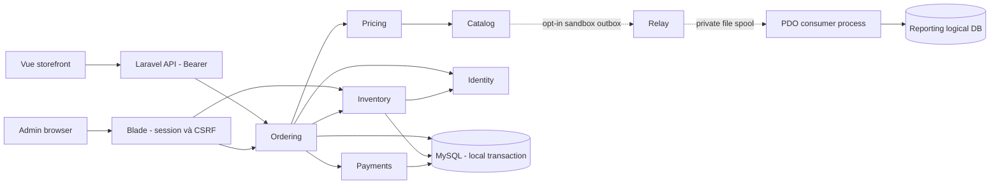

# Case study — nâng cấp thương mại điện tử đa kho

## Bài toán và quyết định

Dự án bán điện thoại có SKU, nhiều kho, storefront Vue và admin Laravel Blade. Thách thức không nằm ở việc thêm CRUD: giá vốn từng bị dùng nhầm như giá giảm, đơn và tồn cần nhất quán, request có thể chạy lại, dữ liệu lịch sử thiếu bằng chứng và migration không phản ánh trọn schema thực tế. Các lỗi và trạng thái ban đầu nằm trong [audit hiện tại](../architecture/current-architecture.md), [phân tích export](../architecture/database-export-analysis.md), [P0 status](../roadmap/P0_STATUS.md).

Chọn Modular Monolith: tận dụng transaction MySQL cho Order–Inventory–Payment thay vì chia service sớm. Public Contracts/DTO và architecture tests tạo ranh giới có thể kiểm tra; domain rules thuần giúp unit test không boot Laravel. Infrastructure giữ Eloquent/locks; composition root bind implementation. Không generic repository hoặc event bus cho mọi CRUD. Các controllers/read adapters cũ vẫn tồn tại; không tuyên bố Clean Architecture toàn repository.

P8 nằm ngoài luồng production mặc định. Diagram lược bỏ nội dung/CMS, read adapters, cache và coupon để tập trung luồng nhất quán tiền/tồn; xem [review](../review/P0_P8_REVIEW.md) cho phạm vi đầy đủ.

## Ba quyết định có thể bảo vệ khi phỏng vấn

**Một kho đủ toàn đơn.** Giảm trạng thái split shipment và phân bổ một phần; trả conflict khi tổng nhiều kho đủ nhưng không kho nào đủ. Khóa và current locking read quyết định số dư, không dựa cache/DTO tồn cũ. Reservation giữ khả năng bán; shipping mới commit physical. Operation keys + transaction + unique identities bảo vệ retry. Đây là MVP có giới hạn nghiệp vụ rõ ràng, không “giải quyết mọi warehouse topology”.

**Thanh toán là bằng chứng riêng.** Browser return không được đánh dấu paid. Online adapter xác minh callback vào ledger, Ordering áp dụng kết quả trong transaction; sandbox kiểm tra amount/reference/signature/replay và race với hủy/expiry. COD completed chưa paid, cần reference thu tiền. Chưa nghiệm thu merchant/IPN public nên online vẫn tắt; refund là manual ledger, không integration provider refund.

**Lịch sử mơ hồ phải được giữ nguyên.** Snapshot order mới và append chứng từ không hợp thức hóa tự động order cũ. Migration additive có backup/restore/clone rehearsal; legacy không đủ bằng chứng đi vào quarantine/hold. Tránh “reconcile = tự sửa số dư” khi không biết hàng thực tế hoặc tiền thực nhận.

## Patterns gắn với vấn đề thực tế

| Vấn đề | Pattern/cơ chế | Code tiêu biểu |
| --- | --- | --- |
| HTTP lẫn orchestration/persistence | Application service + ports/adapters | `app/Modules/Ordering/Application`, `app/Modules/*/Contracts`, `ModuleServiceProvider` |
| Transition sai và khó test | Domain policy | `Ordering/Domain/OrderTransitionPolicy.php`, `Inventory/Domain/StockBalance.php` |
| Payment provider khác protocol | Gateway adapter + ledger | `Payments/Contracts`, `Payments/Infrastructure` |
| Request retry/race | Idempotent operation, transaction, row lock | `Inventory/Infrastructure/IdempotentOperation.php`, `StockWriter.php` |
| Lịch sử thay đổi catalog | Immutable order snapshots và archive | Ordering/Catalog P6; không cascade xóa chứng từ |
| Commit thành công nhưng publish bị crash | Transactional outbox | `app/Experiments/P8/CatalogOutbox.php` |
| Message trùng/sai thứ tự | Inbox + stream version + full snapshot | `ProjectionConsumer.php`, `Envelope.php` |

Version cao thắng chỉ phù hợp full snapshot catalog; không áp dụng cho delta tồn hoặc số tiền. P8 prototype có consumer DB độc lập/quyền hạn hẹp nhưng vẫn chung MySQL host/filesystem/vendor, chưa có độc lập deploy và fault domain như microservice production.

## Kết quả đo và cách hiểu

| Workload | Trước | Sau |
| --- | --- | --- |
| P7 product detail | 11 queries | 8 queries |
| P7 home | 5 queries | 5 queries |
| P7 CSV 100.000 dòng, fresh subprocess | ~374 MiB peak RAM | ~26 MiB |
| P8 cùng DTO 20 catalog cards, 1.000 products × 3 SKU × 5 kho | 2 queries; read p95 6,497 ms | 1 query; read p95 1,227 ms |
| P8 SaveProduct | 5 MySQL statements; p95 7,338 ms | 13 statements; p95 15,747 ms |

Nguồn: [P7 before](../architecture/p7-performance-before.json), [P7 after](../architecture/p7-performance-after.json), [P8 artifact](../architecture/p8-performance.json). Đây là số liệu lịch sử trên máy local PHP 8.3.30/MySQL 8.0.30, không phải thông lượng production hoặc HTTP concurrent p95. P8 read DTO hẹp không được so trực tiếp với toàn API home. Read hash bằng nhau; 1.030 events catch-up khoảng 13,716 giây, zero pending/quarantine trên workload đó.

Lợi ích đọc không đủ chứng minh cần service riêng khi chi phí ghi, vận hành, backlog và eventual consistency tăng. Quyết định giữ monolith, giữ P8 làm prototype có crash/replay tests.

## Nội dung portfolio có thể sử dụng

“Nâng cấp hệ thống Laravel đa kho theo Modular Monolith; triển khai reservation/physical commit, idempotent checkout và đối soát COD trong transaction. Bổ sung MySQL concurrency/recovery tests, kiến trúc module có guard, streaming CSV và thử nghiệm Reporting outbox/inbox. Giảm query detail 11→8 và peak RAM CSV 100k dòng khoảng 374→26 MiB trên workload tổng hợp.”

Không ghi “production microservices”, “zero overselling ở mọi tải” hoặc “đã tích hợp payment production”. [Review](../review/P0_P8_REVIEW.md) công khai các phần chưa nghiệm thu. Demo runnable tại [DEMO.md](DEMO.md); test bằng chứng và source paths giúp người xem kiểm tra thay vì chỉ xem slide.
